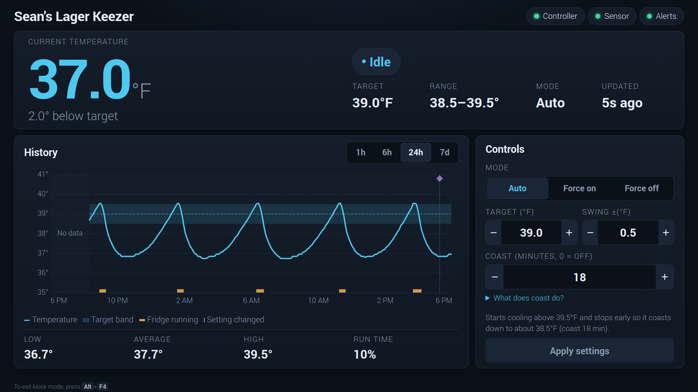
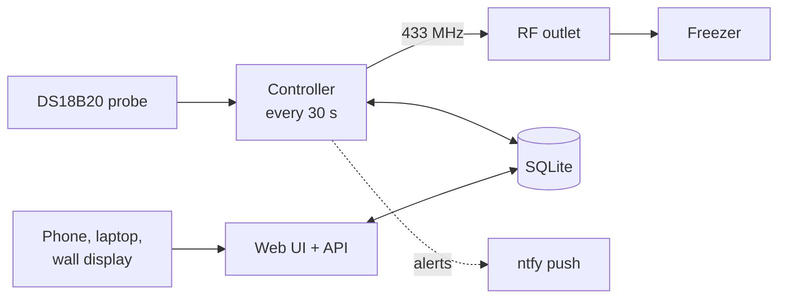

# Lager keezer

Temperature control for a chest freezer used as a kegerator ("keezer"), run from a
Raspberry Pi. It reads a probe in the freezer, switches the freezer's power with a 433 MHz
RF outlet, keeps the temperature where you set it, logs everything, shows it on a phone,
a laptop or a wall-mounted monitor, and sends a push notification if something goes wrong.



## What it does

- **Thermostat with hysteresis and compressor protection**: turns on above the high edge of
  your range, off below the low edge, and never changes state within 5 minutes of the last
  change.
- **Coast-aware control** (optional): a freezer keeps cooling after the compressor stops, so a
  plain thermostat overshoots. Tell it how long that lasts and it stops early. See
  [docs/control-logic.md](docs/control-logic.md).
- **Web UI** for phone and desktop: live temperature, a history chart with setting-change
  markers, and controls for target, swing, coast and mode (auto / force on / force off).
- **Wall display** for a monitor on the Pi: a big, full-screen version with the controls
  beside the chart, started automatically in a kiosk browser.
- **Push alerts** (via [ntfy](https://ntfy.sh)) when it is too warm or too cold for too long,
  when the probe fails, or when the controller itself stops.
- **Safe data handling**: the database lives outside the repository, with a verified nightly
  backup.

## How it fits together



The controller is the only thing that talks to the hardware. The web app only edits settings
in the database and shows what the controller logged. Details: [docs/architecture.md](docs/architecture.md).

## Documentation

| | |
|---|---|
| [docs/architecture.md](docs/architecture.md) | Processes, one control cycle, data model, API, alerts, repository layout |
| [docs/control-logic.md](docs/control-logic.md) | The thermostat rules, the coast problem with real data, coast-aware control, tuning |
| [docs/hardware.md](docs/hardware.md) | Parts, wiring, the probe and the RF outlet |
| [docs/operations.md](docs/operations.md) | Updating, backups and restore, the wall display, troubleshooting, security notes |

## Quick start (on the Pi)

Needs a Raspberry Pi with the probe and RF transmitter wired up and `codesend` built (see
[docs/hardware.md](docs/hardware.md)), and Python 3.9 or newer.

```
git clone https://github.com/seanon414/flask_fridge.git ~/Documents/code/flask_fridge
cd ~/Documents/code/flask_fridge

python3 -m venv venv && . venv/bin/activate
pip install -r requires.txt

cp .env.example .env
nano .env        # set SECRET_KEY (see the file for how to make one); NTFY_TOPIC is optional

export FLASK_APP=app
flask db upgrade     # creates ~/keezer-data/app.db
```

The unit files assume the project is at `/home/pi/Documents/code/flask_fridge` and the user
is `pi`; edit the paths in `deploy/*.service` if yours differ. Then install and start
everything:

```
sudo cp deploy/*.service deploy/*.timer /etc/systemd/system/
sudo systemctl daemon-reload
sudo systemctl enable --now keezer keezer-web keezer-watchdog.timer keezer-backup.timer
```

Open `http://<the-pi's-address>:5000`, and set your **target** and **swing** in the Controls
panel (a fresh install starts at 45 °F ± 1 °F). Until you do, the freezer follows that.

Next steps, each described in [docs/operations.md](docs/operations.md):

- **Push alerts:** pick a long random topic name, put it in `.env` as `NTFY_TOPIC`, subscribe
  to it in the ntfy phone app, restart `keezer keezer-web`, and check with
  `python -m app.scripts.alerts test`.
- **Wall display:** autostart a full-screen browser on the Pi's monitor.
- **Coast-aware control:** after a couple of days of data, run `python -m app.scripts.coast`
  and see what it suggests.
- **A fixed address:** give the Pi a DHCP reservation in your router.

## Configuration

Everything is optional except `SECRET_KEY`. Put these in `.env` (gitignored; the units read
it). See [`.env.example`](.env.example).

| Variable | Default | Purpose |
|---|---|---|
| `SECRET_KEY` | random at each start | Keeps the web UI's CSRF tokens valid across restarts. Set it |
| `NTFY_TOPIC` | unset (alerts off) | Your ntfy topic. Treat it like a password |
| `NTFY_SERVER` | `https://ntfy.sh` | Set if you self-host ntfy |
| `ALERT_WARM_MARGIN` / `ALERT_COLD_MARGIN` | 3 | °F beyond the band before "too warm" / "too cold" counts |
| `ALERT_MINUTES` | 30 | How long a temperature problem must last |
| `ALERT_SENSOR_MINUTES` | 10 | How long the probe must be failing |
| `ALERT_CONTROLLER_MINUTES` | 5 | Silence before "controller down" |
| `ALERT_REMIND_HOURS` | 6 | Re-send a still-active alert after this long |
| `KEEZER_DATA_DIR` | `~/keezer-data` | Where `app.db` lives (keep it outside the repo) |
| `DATABASE_URL` | unset | Full database URL; overrides the above. Tests use `sqlite://` |
| `KEEZER_BACKUP_DIR` / `KEEZER_BACKUP_KEEP` | `~/keezer-backups` / 14 | Backup folder and how many to keep |
| `CODESEND_PATH` | `/home/pi/rfoutlet/codesend` | The RF transmit program |
| `FRIDGE_CODE_ON` / `FRIDGE_CODE_OFF` | `1054003` / `1054012` | Your outlet's codes |
| `W1_BASE_DIR` | `/sys/bus/w1/devices/` | Where the probe appears |

The settings you change day to day (target, swing, coast, mode) are stored in the database and
edited from the web page, not in `.env`.

## Development and tests

The web app can run on any computer (it just shows no readings without a probe), and the
tests need no hardware.

```
python3 -m venv venv && . venv/bin/activate && pip install -r requires.txt

# Python tests. DATABASE_URL=sqlite:// is required: it keeps them off any real database
DATABASE_URL=sqlite:// python -m unittest discover -s app/tests -t .

# Browser-script tests (Node and jsdom; the Pi never needs these)
npm install
npm test
```

Work on a branch, open a pull request, and deploy by following the update steps in
[docs/operations.md](docs/operations.md#updating): back up, test the update, then pull and
restart. Do not run `flask db init`: the migrations already exist.

## License

MIT, see [LICENSE](LICENSE).
