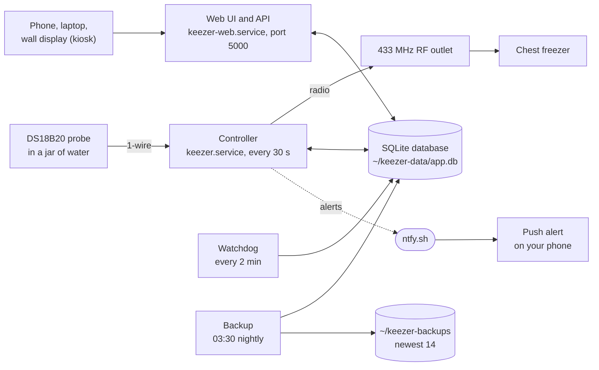
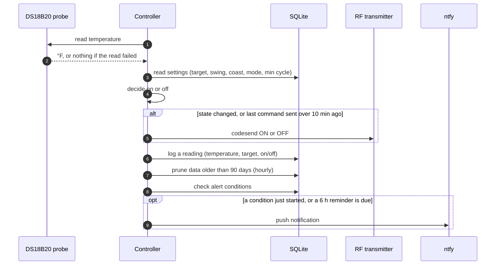
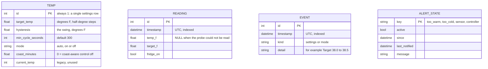
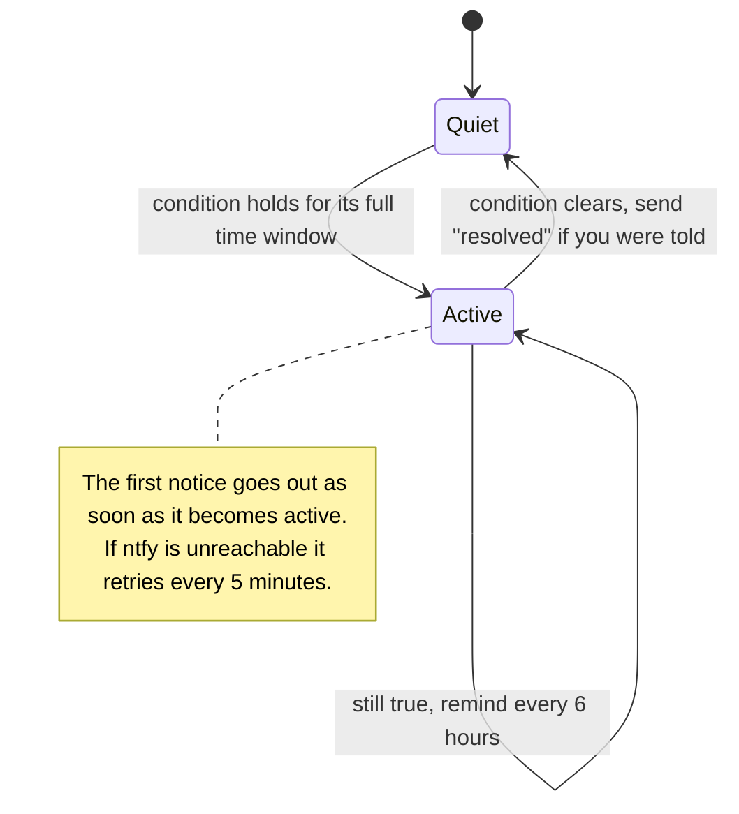

# Architecture

How the pieces fit together, what talks to what, and why it is built this way.
For the thermostat maths see [control-logic.md](control-logic.md); for running and
fixing it see [operations.md](operations.md); for wiring see [hardware.md](hardware.md).

## The big picture



The watchdog and the backup job also send notifications through ntfy (when the controller goes
silent, and when a backup fails). The important rules:

- **One writer to the hardware.** Only the controller reads the probe and drives the RF
  transmitter. The web app never touches either; it only edits settings in the database
  and reads the readings the controller logged.
- **The database is the meeting point.** Settings flow web &rarr; database &rarr; controller
  (picked up on its next 30 s cycle, no restart). Readings flow controller &rarr; database
  &rarr; web.
- **The controller can't report its own death**, so a separate timer (the watchdog) checks
  that readings are still arriving and raises an alert if they stop.

## The processes

| Unit | What it does | How it runs |
|---|---|---|
| `keezer.service` | The control loop: read probe, decide, switch the RF outlet, log a reading, check alerts. `app/scripts/controller.py` | Always on, restarts after 10 s |
| `keezer-web.service` | The web UI and JSON API (Flask served by waitress on port 5000) | Always on, restarts after 10 s |
| `keezer-watchdog.timer` | Alerts if the controller has not logged a reading for 5 min. `app/scripts/watchdog.py` | Every 2 min |
| `keezer-backup.timer` | Consistent, integrity-checked copy of the database; keeps 14. `app/scripts/backup.py` | 03:30 nightly (catches up if the Pi was off) |
| `keezer-deploy.timer` | Checks GitHub for a new `master` and installs it once its tests pass, restarting only what changed. `app/scripts/autodeploy.py` | 3 min after each run; 10 min after boot |
| `deploy/kiosk.sh` | Waits for the web service, then opens the wall display in full-screen Chromium | Started by the desktop session autostart |

All units read `.env` (gitignored) for secrets and tuning; see the configuration table in the
[README](../README.md#configuration).

## One control cycle



Things worth knowing:

- **A failed read holds the current state.** The probe returns nothing (not a made-up number)
  when the checksum fails five times, the output is malformed, or it reports the sensor's
  85 °C power-on default. The controller then keeps doing whatever it was doing and logs a
  reading with no temperature.
- **The RF command is repeated every 10 minutes** even when nothing changed, so a missed
  radio packet cannot leave the outlet in the wrong state for long.
- **After a restart** the controller recovers the last known on/off state from the reading
  log instead of guessing, then re-sends it.
- **Alerts can never break control.** The alert check is wrapped so that an error in it is
  logged and ignored.

## Data model



The four tables are independent (no foreign keys). Timestamps are stored as naive UTC and
sent to the browser with a trailing `Z`. `reading` and `event` rows older than 90 days are
deleted by the controller once an hour. Schema changes go through Flask-Migrate/Alembic
(`migrations/versions/`); SQLite needs batch mode for column changes, which the existing
migrations already use.

## HTTP API

All JSON. `POST`s need the CSRF token from the page's `<meta name="csrf-token">` in an
`X-CSRFToken` header (the page's script does this for you).

| Method and path | Purpose |
|---|---|
| `GET /api/status` | Current settings, latest temperature and on/off state, controller and sensor health, active alerts, whether push alerts are configured, and a `version` string |
| `GET /api/history?hours=N` | Readings for the last N hours (0.5 to 720), averaged into at most 300 points, plus min/average/max, compressor duty %, and the setting-change events |
| `POST /api/settings` | `target_temp` (20 to 70 in 0.5 steps) and `hysteresis` (0.5 to 10) are required; `coast_minutes` (0 to 60) is optional and left unchanged if omitted. Changes are logged as chart markers |
| `POST /api/mode` | `mode`: `auto`, `on` or `off` |

`version` changes when the web service restarts or any file in `static/` or `templates/` is
modified. The page polls it and reloads itself when it changes, which is how the wall
display stays current without anyone touching it.

## Alerts

Push notifications go through [ntfy](https://ntfy.sh) and stay off until `NTFY_TOPIC` is set.
The state of each alert lives in the `alert_state` table, so it survives restarts and is
shared between the controller and the watchdog.



| Alert | Fires when | Default |
|---|---|---|
| Too warm | Every reading for the window is above `target + swing + margin` | 3 °F margin, 30 min |
| Too cold | Every reading for the window is below `target − swing − margin` | 3 °F margin, 30 min |
| Sensor failure | No valid temperature for the window | 10 min |
| Controller down (watchdog) | No reading logged for the window | 5 min |

A window only counts if readings cover it, so a restart does not instantly raise or clear
an alert. Active alerts are also shown in the web UI. The thresholds are environment
variables (see the README).

## The web page

`app/templates/index.html` is a shell; `app/static/app.js` fills it in from the API and draws
the history chart on a canvas. No framework and no build step.

- Polls `/api/status` every 5 s and `/api/history` every 60 s.
- `?display=1` switches to the wall display layout (big numbers, controls in a side panel);
  add `&readonly=1` to hide the controls. A small "To exit kiosk mode, press Alt+F4" line
  appears on this layout only.
- Reloads itself when the server `version` changes, and also if the page has not shown live
  data a minute after loading while the server is reachable (the "new script, old page"
  case during an update).
- Returns to the 24 h chart after 5 idle minutes on another range; hides the mouse cursor
  when idle on the wall display.
- Test seams in the production script: `window.keezerReload`, `window.keezerIdleMs`,
  `window.keezerBootMs`.

## Repository layout

```
app/
  __init__.py          Flask app, database, CSRF protection
  config.py            where the database lives
  models/temp.py       settings, readings, events, alert state
  scripts/
    controller.py      the control loop
    control_logic.py   pure decision functions (thermostat, coast-aware stop)
    coast.py           study the freezer's coast time; set it from the command line
    thermometer.py     DS18B20 reader
    fridge_control.py  RF outlet commands via codesend
    alerts.py          ntfy notifier and alert state machine
    watchdog.py        "is the controller still logging?"
    backup.py          consistent database backup
  views/               index page and JSON API
  static/, templates/  the web page
  tests/               Python tests
deploy/                systemd units and the kiosk launcher
docs/                  this documentation, with a tool that draws the cycle chart
frontend_tests/        browser-script tests (jsdom, run with npm test)
migrations/            database migrations
```

`Dockerfile` and `docker-compose.yml` are left over from the first version of the project.
They target Python 2 and the old layout and do not work for the controller (which needs the
Pi's probe and radio). Treat them as unused.

## Design decisions

- **SQLite, no server.** One small file, easy to back up, and plenty for one reading every
  30 seconds.
- **The database lives outside the git repository** (`~/keezer-data/`). Git can silently
  overwrite or delete files inside a checkout when you switch branches or pull; that cost
  this project 2 h 40 min of readings once. See [operations.md](operations.md#why-the-database-is-outside-the-repo).
- **A single controller process and a small, pure decision function.** The thermostat logic
  has no database, clock or hardware in it, so it is tested exhaustively and cheaply.
- **Hold, don't guess.** With no valid reading the controller keeps its state rather than
  inventing a temperature.
- **No login.** This is meant for a home network. Do not expose port 5000 to the internet
  (no port forwarding, no public tunnel); the UI can change the freezer's target and force
  the compressor on or off.
