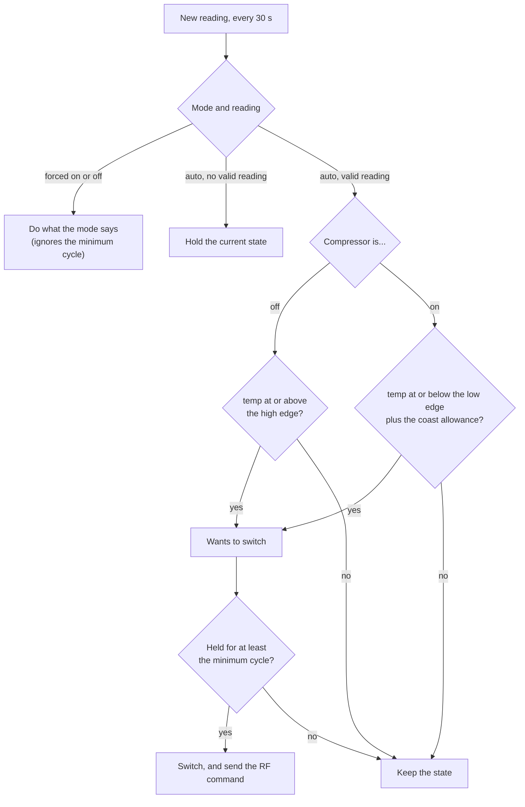
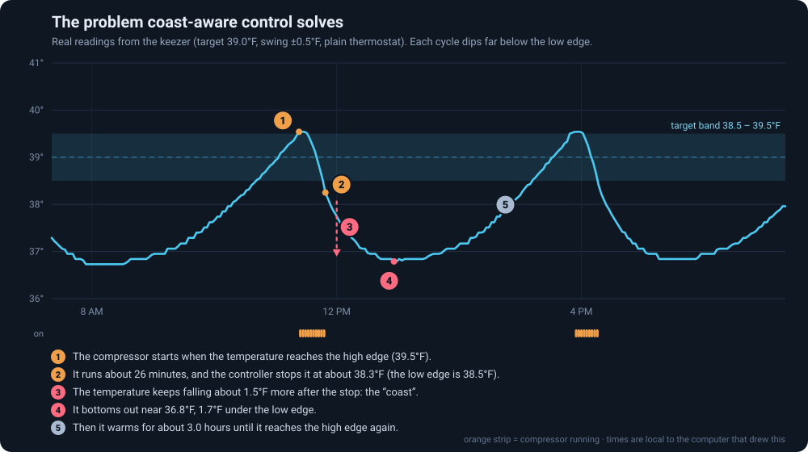

# Control logic

How the controller decides when the compressor runs. The code is in
[`app/scripts/control_logic.py`](../app/scripts/control_logic.py) (pure functions, no
database or hardware) and is driven by
[`app/scripts/controller.py`](../app/scripts/controller.py).

## The settings

| Setting | Meaning | Where to change it |
|---|---|---|
| **Target** | The temperature you want, °F, in half-degree steps (20 to 70) | Controls panel |
| **Swing** (hysteresis) | How far either side of the target is acceptable, °F (0.5 to 10). Target 39 with swing 0.5 gives the band 38.5 to 39.5 | Controls panel |
| **Coast** | Minutes the temperature keeps falling after the compressor stops. 0 turns coast-aware control off | Controls panel, or `python -m app.scripts.coast set N` |
| **Minimum cycle** | Seconds a state must be held before it may change, to protect the compressor (default 300) | Database only (`temp.min_cycle_seconds`) |
| **Mode** | `auto` follows the thermostat; `on` and `off` force the compressor and ignore everything else, including the minimum cycle | Controls panel |

## A plain thermostat (hysteresis)

Two edges, one either side of the target: the **high edge** (`target + swing`) and the
**low edge** (`target − swing`).

- Compressor off and the temperature reaches the high edge or above: turn on.
- Compressor on and the temperature reaches the low edge or below: turn off.
- In between: keep doing what it was doing. This is what stops it flapping on and off.
- Never change state within the minimum cycle (5 minutes) of the last change.
- On the very first cycle (state unknown), on if the temperature is at or above the target,
  off otherwise.
- No valid reading: hold the current state.



(The "coast allowance" is zero unless coast is set; see below.)

## The problem: a freezer coasts

After the compressor stops, the cold plate and walls keep pulling the temperature down for a
while. A thermostat that waits for the low edge therefore overshoots it. This is what one
real cycle of this keezer looks like with a plain thermostat (target 39.0 °F, swing 0.5 °F;
the probe is in a jar of water at the bottom of the freezer):



Measured over 24 hours (five complete cycles) with coast off:

| | Value |
|---|---|
| Cycle period | about 4.8 hours |
| Compressor on per cycle | about 25 minutes (about 10 % of the time) |
| Where it stops | 38.4 °F, at the low edge |
| How far it keeps falling afterwards | about 1.65 °F, to about 36.7 °F |
| Highest point | about 39.5 °F |
| Average temperature | 37.7 °F, against a 39.0 °F target |
| Time inside the 38.5 to 39.5 °F band | about 21 % |

So a 1 °F band produced a swing of about 2.8 °F, centred a degree under the target. The
controller was doing exactly what it was told; the plain rule just cannot see the coast
coming.

## Coast-aware control

If you tell the controller how long the slide lasts, it can allow for it. While the
compressor is running it measures how fast the temperature is falling, then stops once:

```
temperature − (cooling rate × coast minutes)  ≤  low edge
```

In words: stop when, if the temperature carried on falling for `coast` more minutes at its
current speed, it would land on the low edge.

Worked example, from the replay of a real cooling phase (target 39, swing 0.5, coast 18):

- Compressor has been on for about 14 minutes; temperature 39.31 °F, falling 0.045 °F per
  minute.
- Allowance: 0.045 × 18 = 0.81 °F. 39.31 − 0.81 = 38.50, which has reached the low edge,
  so it stops here, instead of continuing down to 38.4 °F and then coasting to 36.7 °F.

Safeguards, all in `decide()`:

- **Capped at 2 °F early**, however fast the fall, so one bad rate cannot stop the compressor
  far from where it should.
- **The minimum cycle still applies**, so the compressor always runs at least 5 minutes.
- **No rate, no change.** The rate is a least-squares slope over the last 6 minutes of
  readings and needs at least 4 readings spanning 2.5 minutes. Just after a restart there
  is no rate, so it behaves as a plain thermostat until there is.
- **Only the stop changes.** The start rule is untouched.
- **Off by default** (`coast = 0`), which is exactly the plain thermostat.

The cost is shorter compressor runs and more cycles per day. If you would rather have fewer
starts, widen the swing instead.

### Finding the right number

The coast time is a property of your freezer, so measure it rather than guess:

```
python -m app.scripts.coast              # study the last 3 days and suggest a value
python -m app.scripts.coast --days 7
python -m app.scripts.coast set 18       # turn it on (takes effect within 30 s)
python -m app.scripts.coast set 0        # back to a plain thermostat
```

The study looks at every complete compressor stop (readings unbroken from a few minutes
before the stop until the next start) and divides how far the temperature kept falling by
how fast it was falling at the stop. On this freezer that gave 14.0, 17.7, 18.9 and
20.9 minutes, so the median, **18.3**, was used.

While coast-aware control is running, the controller also writes the same measurement to
its log after each stop:

```
journalctl -u keezer | grep -E "Coast:|Fridge ->"
```

For example (illustrative numbers):

```
Coast: stopped at 38.62F, bottomed at 38.10F (0.52F lower) before cooling again
```

Re-run the study after a day or two and adjust: because the compressor now stops earlier,
the slope at the stop changes, and so does the best number.

## Tuning notes

- The probe's position matters. A probe in a jar of water at the bottom sees a smoother,
  slower temperature than one in the air; that is the temperature your beer is closest to.
  Move the probe and the coast time changes; re-run the study.
- If the temperature settles too high after switching coast on, lower the number (stop later).
  If it still dips well under the low edge, raise it.
- Very small swings (0.5 °F) are harder for any thermostat. A larger swing means fewer
  starts per day and a steadier compressor.
