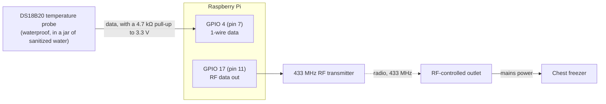

# Hardware and wiring

What the keezer is built from and how the Pi talks to it. This is written from the working
setup; **check the pin and wiring details against your own build** before relying on them,
because a wiring mistake is the one thing the software cannot detect.



## Parts

| Part | Notes |
|---|---|
| Raspberry Pi 4 | Raspberry Pi OS "Bullseye" (32-bit, `armv7l`), Python 3.9 |
| DS18B20 1-wire temperature probe | Waterproof type. The Pi sees it as `/sys/bus/w1/devices/28-…/w1_slave` |
| 433 MHz RF transmitter module | Connected to the Pi's GPIO |
| 433 MHz RF-controlled mains outlet | Learns a remote's code; the Pi plays that code back |
| Chest freezer | Plugged into the RF outlet, so the Pi switches it by switching the outlet |

## The temperature probe (1-wire)

1. Enable the 1-wire overlay by adding this line to `/boot/config.txt`, then reboot:
   ```
   dtoverlay=w1-gpio,gpiopin=4
   ```
2. Wire the DS18B20: ground to ground, power to 3.3 V, data to GPIO 4 (physical pin 7), with
   a 4.7 kΩ resistor between data and 3.3 V (the usual 1-wire pull-up).
3. Check it is seen:
   ```
   ls /sys/bus/w1/devices/        # a 28-xxxxxxxxxxxx entry should appear
   cat /sys/bus/w1/devices/28-*/w1_slave
   ```
   The first line must end in `YES` (the checksum), and the second contains `t=` followed by
   the temperature in thousandths of a degree Celsius.

`app/scripts/thermometer.py` loads the `w1-gpio` and `w1-therm` kernel modules the first time
it reads, retries a bad checksum up to 5 times, and treats the sensor's `85.0 °C` power-on
default as a failed read. `W1_BASE_DIR` overrides where it looks for the sensor.

## The RF outlet

The Pi switches the freezer's outlet with `codesend`, from the
[timleland/rfoutlet](https://github.com/timleland/rfoutlet) project (built on 433Utils and
rc-switch). On this Pi it lives at `/home/pi/rfoutlet/codesend`. It sends a numeric code on
GPIO 17 (wiringPi pin 0), which is also what `codesend`'s own log line shows (`PIN: 0`).

1. Build `codesend` and `RFSniffer` by following that project's guide (it needs wiringPi,
   whose original download site is gone; use the community-maintained fork at
   `github.com/WiringPi/WiringPi`).
2. Learn your outlet's codes: run `./RFSniffer`, press the outlet's remote **on** and **off**
   buttons, and note the numbers it prints.
3. Test: `./codesend <on-code>` should switch the outlet on, and the off code should switch it
   off.
4. Tell the keezer about them if they differ from the defaults, in `.env`:

   | Setting | Default | Meaning |
   |---|---|---|
   | `CODESEND_PATH` | `/home/pi/rfoutlet/codesend` | Where the binary is |
   | `FRIDGE_CODE_ON` | `1054003` | Code that switches the outlet on |
   | `FRIDGE_CODE_OFF` | `1054012` | Code that switches it off |

The controller calls `codesend` with a 10-second timeout, one transmission at a time, and
treats a non-zero exit as a failed send (it retries on the next cycle).

Radio is one-way. The Pi cannot tell whether the outlet heard it, which is why the controller
repeats the current command every 10 minutes.

## Safety notes

- The outlet and freezer are mains-powered. Use an outlet rated for the freezer's running
  current, including the compressor's start-up surge.
- If the controller or the Pi stops, the outlet keeps its last state. If that state is "on"
  the freezer keeps cooling (and may freeze the contents); if "off" it warms up. The
  watchdog and the too-warm / too-cold alerts exist for exactly this; set `NTFY_TOPIC` and
  test it (`python -m app.scripts.alerts test`).
- The compressor is protected from rapid cycling by the 5-minute minimum cycle, but forcing
  the mode from the UI bypasses it. Avoid flipping Force on / Force off repeatedly.
