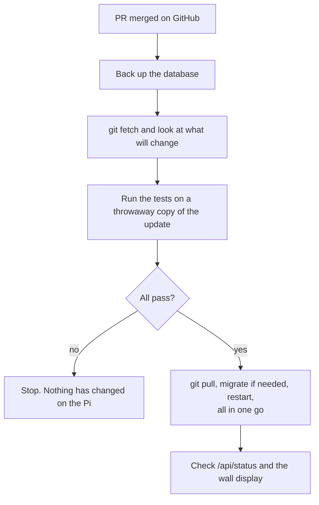

# Operations

Running, updating, backing up and fixing the keezer. Commands are run on the Pi (`ssh pi@<ip>`)
from the project folder with the virtualenv active:

```
cd ~/Documents/code/flask_fridge && . venv/bin/activate
```

## Everyday checks

```
systemctl is-active keezer keezer-web keezer-watchdog.timer keezer-backup.timer
curl -s http://127.0.0.1:5000/api/status | python -m json.tool | head -30
journalctl -u keezer -f                          # the controller, live
journalctl -u keezer | grep -E "Coast:|Fridge ->"  # every start and stop
systemctl list-timers | grep keezer              # next watchdog and backup runs
```

Healthy looks like: `controller_ok: true`, `sensor_ok: true`, no active alerts, and a
reading younger than about a minute.

## Branch protection and CI

Every pull request runs the **CI** workflow (`.github/workflows/ci.yml`) on GitHub's servers:

| Check | What it runs |
|---|---|
| **Python tests** | Python 3.9 (what the Pi runs), `pip install -r requires.txt`, the whole suite against an in-memory database |
| **Frontend tests** | Node 22, `npm ci`, `npm test` (the browser script and the chart tool) |

`master` is **protected**: a pull request cannot be merged until both checks pass, and that
applies to the repository owner too. Force-pushes to `master` and deleting it are blocked. The
rule is a GitHub setting, not a file in the repository. To see or change it, use the repository's
Settings, Branches page, or:

```
gh api repos/seanon414/flask_fridge/branches/master/protection
```

Things to know:

- A red check means a test failed: open the check's details on the pull request, fix it, push
  again, and CI re-runs by itself.
- If you ever need to merge past a broken or unavailable check, remove or relax the rule on
  that Settings page first, then restore it. Nothing else bypasses it.
- **Branch protection only works on a public repository** (or with a paid GitHub plan). If you
  make this repository private on a free plan, the rule stops being enforced and CI becomes
  advisory: the tests still run and show a tick or a cross, but nothing blocks the merge.
- The CI actions are pinned to exact commits. Update them on purpose, not by accident.
- To run the same checks yourself: `DATABASE_URL=sqlite:// python -m unittest discover -s app/tests -t .`
  and `npm test`.

## Updating

Unit and data files live outside the code, so an update is a `git pull`, a database
migration if there is one, and a service restart. Do it in this order:



```
python -m app.scripts.backup                       # 1. a fresh backup first
git fetch origin && git diff --stat HEAD origin/master   # 2. what is about to change?

rm -rf /tmp/keezer-test && mkdir /tmp/keezer-test  # 3. test the update without touching
git archive origin/master | tar -x -C /tmp/keezer-test   #    the live checkout
(cd /tmp/keezer-test && DATABASE_URL=sqlite:// python -m unittest discover -s app/tests -t .)
rm -rf /tmp/keezer-test

# 4. only if every test passed; pull and restart back to back
git pull --ff-only && FLASK_APP=app flask db upgrade && sudo systemctl restart keezer keezer-web
```

Notes:

- The tests **must** be run with `DATABASE_URL=sqlite://` (an in-memory database). They refuse
  to run otherwise, so they can never touch the live data.
- Restart only what changed: `keezer-web` for templates, static files, views and API code;
  `keezer` too for anything in `app/scripts/` or `app/models/`. A controller restart costs
  about 10 seconds; it recovers its state from the log and re-sends it.
- **Pull and restart back to back** when a change touches both a template and `app.js`.
  In the gap, the old web process serves its cached old template while the new script is
  already on disk; the wall display reloads in that gap, loads the new script against the
  old page, and sticks on "Waiting for data…". The page now reloads itself after a minute
  if that happens, but avoiding the gap is better. A change that only touches static
  files needs no restart; the wall display reloads itself.
- A pull that adds a migration needs `flask db upgrade` **before** the restart. The upgrade
  works on the live database, which is why step 1 comes first.
- `git pull --ff-only` refuses anything but a clean fast-forward. If it refuses, stop and
  look; do not force it.

## Backups and restoring

The database is `~/keezer-data/app.db` (override with `KEEZER_DATA_DIR` or `DATABASE_URL`).
A timer copies it at 03:30 into `~/keezer-backups/` (newest 14 kept) using SQLite's own
backup API, so it is safe while the controller is writing. Each copy is integrity-checked;
an empty, missing or table-less database is refused rather than backed up, and a failure
sends a push notification.

```
sudo cp deploy/keezer-backup.service deploy/keezer-backup.timer /etc/systemd/system/
sudo systemctl daemon-reload && sudo systemctl enable --now keezer-backup.timer
python -m app.scripts.backup          # a manual one, any time
```

Restore:

```
sudo systemctl stop keezer keezer-web keezer-watchdog.timer
cp ~/keezer-backups/app.db.<timestamp> ~/keezer-data/app.db
sudo systemctl start keezer keezer-web keezer-watchdog.timer
```

While the controller is stopped nothing regulates the freezer. The outlet keeps whatever
state it was last told, so restore promptly.

### Moving an old in-repo database

Early installs kept `app/app.db` inside the repository. That file still works until it is
moved (the app logs a warning), but move it:

```
cp app/app.db ~/app.db.before-move                # a safety copy first
sudo systemctl stop keezer keezer-web keezer-watchdog.timer
mkdir -p ~/keezer-data && cp app/app.db ~/keezer-data/app.db
python -c "import sqlite3; print(sqlite3.connect('/home/pi/keezer-data/app.db').execute('select count(*) from reading').fetchone())"
mv app/app.db app/app.db.moved
sudo systemctl start keezer keezer-web keezer-watchdog.timer
```

If `~/keezer-data/app.db` exists it wins over any old `app/app.db`, so never leave a stale
or empty copy there.

### Why the database is outside the repo

Git silently overwrites or deletes files inside a checkout when you switch branches or pull,
**even files in `.gitignore`**, if the target commit tracks a file at that path. This project
lost 2 h 40 min of readings that way once (a branch switch deleted the live database), and
nearly once more by moving the data before the code that expected it was deployed. Hence:
data lives in `~/keezer-data/`, backups in `~/keezer-backups/`, and every update starts with
a backup.

## The wall display (kiosk)

`http://127.0.0.1:5000/?display=1` is a full-screen view for a monitor on the Pi: big
temperature, tall chart, and the controls in a side panel for a mouse and keyboard. Add
`&readonly=1` to hide the controls.

To start it automatically on Raspberry Pi OS "Bullseye" (LXDE on X11; check with
`cat /etc/os-release`), run this from the project folder:

```
mkdir -p ~/.config/lxsession/LXDE-pi
cp /etc/xdg/lxsession/LXDE-pi/autostart ~/.config/lxsession/LXDE-pi/autostart
sed -i '/xscreensaver/d' ~/.config/lxsession/LXDE-pi/autostart
cat >> ~/.config/lxsession/LXDE-pi/autostart <<EOT
@xset s off
@xset -dpms
@xset s noblank
@$PWD/deploy/kiosk.sh
EOT
sudo reboot
```

- The `sed` line matters: the default autostart runs `xscreensaver`, which blanks the kiosk
  with a random pattern after about 10 minutes without a keypress while the dashboard keeps
  running underneath. `xset s off` does not stop it.
- [`deploy/kiosk.sh`](../deploy/kiosk.sh) waits for the web service, so the browser never opens
  on an error page, then opens the dashboard full screen. It logs to `~/kiosk.log`.
- It uses `127.0.0.1`, not `localhost`: the web server listens on IPv4 only, so a damaged
  `/etc/hosts` that makes `localhost` resolve to IPv6 only would otherwise stop it starting.
- After a power-on the desktop takes roughly 1½ minutes to appear (this Pi starts several
  other services), then the dashboard opens within seconds.
- To leave kiosk mode press `Alt+F4` (a reminder is printed at the bottom of the screen).
  The kiosk does not come back until the next login or reboot. To restart it without
  rebooting:
  ```
  DISPLAY=:0 XAUTHORITY=$HOME/.Xauthority nohup setsid ~/Documents/code/flask_fridge/deploy/kiosk.sh >/dev/null 2>&1 &
  ```
- On the newer "Bookworm" OS (Wayland) the autostart file is different and these steps need
  adapting.

## Troubleshooting

| What you see | Likely cause | What to do |
|---|---|---|
| Wall display is a plain white or multicoloured screen, but the dashboard works from another computer | `xscreensaver` is running over the kiosk | `xscreensaver-command -exit`, then remove it from the autostart (the `sed` line above) |
| Pi shows the desktop, never the dashboard | The kiosk script did not start, or `localhost` does not resolve | Read `~/kiosk.log`. Check `getent hosts localhost` says `127.0.0.1`; line 1 of `/etc/hosts` should be `127.0.0.1 localhost` |
| Wall display stuck on "Waiting for data…" with empty fields | A new script met an old cached page during an update | It self-heals within a minute if the server is up. Otherwise restart the kiosk (command above) |
| "Can't reach the web service. Retrying…" banner | `keezer-web` is down or still starting (it takes ~20 s on this Pi) | `systemctl status keezer-web`; it recovers by itself |
| Error 500 mentioning `no such table` | The app is pointing at an empty or wrong database | Check `~/keezer-data/app.db` exists and is not 0 bytes; check no stray `DATABASE_URL`; restore a backup if needed |
| Controller pill red, "Controller down" alert | `keezer` stopped or hung | `systemctl status keezer`, `journalctl -u keezer -n 50`; `sudo systemctl restart keezer` |
| Sensor pill red, "sensor failure" alert | Probe unplugged, bad connection, or 1-wire not loaded | `ls /sys/bus/w1/devices/` should list a `28-…` device; check `dtoverlay=w1-gpio,gpiopin=4` in `/boot/config.txt` |
| No push alerts | `NTFY_TOPIC` unset, wrong topic, or the units not restarted after editing `.env` | `set -a; . ./.env; set +a; python -m app.scripts.alerts test`; restart `keezer keezer-web` |
| Can't SSH or open the page after a while | The Pi's IP changed | Reserve its address in the router (DHCP reservation / IP binding); see below |
| Slow or timing-out SSH for a few minutes after a boot | The Pi is busy starting services; Wi-Fi blips briefly | Wait. After about 6 minutes it is steady. An Ethernet cable removes the blips |
| Temperature chart has a "No data" band | The controller was not logging then (restart, outage) | Normal. A gap of more than about 2½ minutes between readings is drawn as "No data" |

### Seeing what the wall display is actually showing

Over SSH:

```
DISPLAY=:0 XAUTHORITY=$HOME/.Xauthority scrot /tmp/screen.png      # then scp it to your computer
DISPLAY=:0 XAUTHORITY=$HOME/.Xauthority xscreensaver-command -time  # is a screensaver active?
```

### Keeping the Pi at a fixed address

Give it a DHCP reservation in your router (on ASUS routers: LAN, DHCP Server, Manual
Assignment, or IP Binding in the app) using the MAC address of the interface it actually
uses (`cat /sys/class/net/wlan0/address` for Wi-Fi). `keezer.local` (mDNS) is announced by
the Pi but did not resolve from a wired Windows PC in testing, so do not rely on it.

## Security notes

- The web UI has **no login** and can change the target, force the compressor and change the
  coast setting. Keep it on your home network. Do not port-forward 5000, and do not add it
  to a public tunnel. (If the Pi also runs a tunnel for something else, check its
  `ingress` rules do not point at port 5000.)
- The ntfy topic is effectively a password: anyone who knows it can read your alerts. Keep it
  in `.env` (gitignored), not in the repository.
- `SECRET_KEY` in `.env` keeps the web UI's CSRF tokens valid across restarts. Without it a
  random key is generated at every start, so an open page's Apply button fails after a restart
  until it is reloaded.

## Other things on this Pi

This Pi also runs Homebridge, PM2, Docker and a Cloudflare tunnel. They are not part of this
project, but they make boot slower and busier, which is why services take a minute or two
to settle after power-on.
